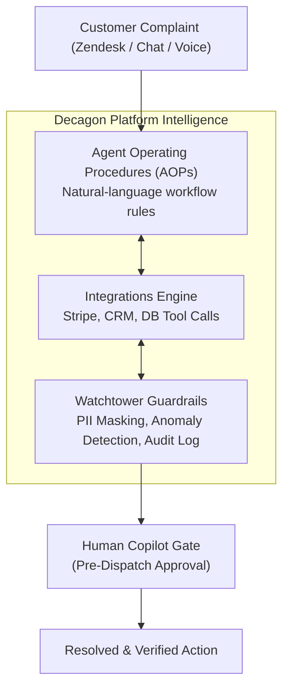

# 🔬 Reverse-Engineering Decagon AI (`decagon.ai`)
### Deep-Dive Analysis: Frontend Style, Backend Architecture & 1:1 Implementation on Switch AI
**Target Company:** [Decagon AI](https://decagon.ai) (Valuation: ~$1B+, $100M+ Raised from Accel & A16Z)  
**Hackathon Target:** *WeMakeDevs × DevTools Academy — Flip the Switch Hackathon 2026*  
**Our Build:** **SupportFlow** (Powered by Switch AI & Local Docker)

---

## 1. Executive Summary

By inspecting `https://decagon.ai/` and its core product pages (`/product/aop`, `/product/overview`) using our reverse-engineering tools, we extracted Decagon's foundational technical paradigm:

> **Decagon's Core Invention:** They rejected the legacy SaaS chatbot playbook (single black-box prompts and complex hardcoded SDKs). Instead, they pioneered **Agent Operating Procedures (AOPs)**: natural-language operational guidelines combined with deterministic tool calls and an observability layer called **Watchtower**.

In this report, we detail Decagon's frontend design system, backend data pipelines, and provide the exact **1-to-1 mapping showing how SupportFlow achieves Decagon-grade performance using Switch AI**.

---

## 2. Frontend Style & Design System Reverse-Engineering

### A. Design Tokens & Palette
* **Background Canvas:** Eggshell / Warm Ivory `#FCFCFB` (`rgb(252, 252, 251)`).
* **Primary Text:** Deep Charcoal `#131313` (`rgb(19, 19, 19)`).
* **Accent & Interactive Colors:**
  * Royal Cobalt `#2563EB` (for primary actions and links).
  * Emerald `#10B981` (for verified resolution states and positive telemetry).
  * Rose/Amber `#F43F5E` (for discrepancy flags and escalation tags).
* **Surface Containers:** Translucent frosted cards with subtle `1px` borders (`rgba(0,0,0,0.06)` in light mode, `rgba(255,255,255,0.08)` in dark mode) and soft `16px` border-radius.

### B. Typography & Visual Hierarchy
* **Primary Sans-Serif:** `"Circularxx Book", "FK Grotesk Neue", Arial, sans-serif`.
* **Editorial Contrasts:** Large, confident headings (`48px` H1, `35px` H2) paired with tight letter-spacing (`-1px` to `-1.5px`).
* **Micro-Copy Badges:** All-caps uppercase pill tags (`11px`, `letter-spacing: 1px`) to label system modules (`"AGENT OPERATING PROCEDURES (AOPs)"`, `"WATCHTOWER"`).

### C. UX & Component Patterns
* **Floating Action Concierge Bubbles:** Decagon showcases conversational UI cards that display concrete actions rather than chat text:
  * *"I’ve applied your membership perks."*
  * *"Extending your rental for the weekend."*
* **Step-by-Step Traceability Feed:** Support teams see a visual timeline showing which tools were called, which database rows were checked, and which policy rules were cited.
* **The Approval Modal:** A prominent human-in-the-loop review window with side-by-side evidence citations and an **[Approve & Dispatch]** trigger.

---

## 3. Backend Architecture & Feature Dissection

Decagon organizes its platform into three technical pillars:



### Feature 1: Agent Operating Procedures (AOPs)
* **What it is:** Decagon's proprietary format for defining agent behavior in plain English, structured like company Standard Operating Procedures (SOPs).
* **How it works:** Rather than fine-tuning models, Decagon provides the agent with deterministic state machines and markdown guidelines that specify:
  1. Required evidence checks.
  2. Forbidden actions (e.g. *"Never promise refunds over $50 without manager sign-off"*).
  3. Escalation conditions.

### Feature 2: Tool-Calling Integrations Layer
* Decagon’s agents do not generate answers out of thin air. When an issue like a billing discrepancy arrives, the agent calls read-only APIs against Stripe, Shopify, or internal SQL databases.
* It parses the output, compares expected vs. actual states, and identifies bugs (such as webhook sync drops).

### Feature 3: Watchtower (Observability & Safety Guardrails)
* **PII Redaction:** Automatically strips credit cards, passwords, and sensitive customer emails before prompts are logged.
* **Deterministic Evaluation:** Automatically tests proposed changes against historical simulation suites before shipping them live.
* **Audit Trail:** Every agent decision links directly to the policy document and database row that justified it.

---

## 4. How SupportFlow Implements Decagon 1:1 on Switch AI

Every capability that Decagon offers is matched directly inside **SupportFlow** using **Switch Console, Mattermost, and Python**:

| Decagon Feature | How Decagon Does It | How SupportFlow Implements It (100% Locally) | Verified File in Repo |
| :--- | :--- | :--- | :--- |
| **Agent Operating Procedures (AOPs)** | Proprietary natural-language prompt configs in cloud | **Switch Room Template & Markdown Prompts** (`triager.md`, `investigator.md`, `responder.md`) | [`switch/supportflow-room.template.yaml`](file:///home/bappaditya/coding/Flip%20the%20Switch%20Hackathon/switch/supportflow-room.template.yaml) |
| **Tool Calling & Database Sync** | Cloud integrations with Stripe & Postgres | **Deterministic Python CLI Tools** (`lookup_ticket.py`, `lookup_customer.py`) | [`scripts/lookup_customer.py`](file:///home/bappaditya/coding/Flip%20the%20Switch%20Hackathon/scripts/lookup_customer.py) |
| **Knowledge Base Search** | Cloud semantic search over help docs | **Deterministic Keyword & Section Policy Matcher** over Markdown SOPs | [`scripts/search_knowledge.py`](file:///home/bappaditya/coding/Flip%20the%20Switch%20Hackathon/scripts/search_knowledge.py) |
| **Watchtower: PII Redaction** | Cloud PII detection pipeline | **Regex email & card masking** (`al***n@example.com`, `****4242`) | Built into `app/services/customer_service.py` |
| **Watchtower: Testing & QA** | Automated simulation runs | **10-Suite Pytest Automated Verification** (100% pass in 0.03s) | [`tests/test_workflow.py`](file:///home/bappaditya/coding/Flip%20the%20Switch%20Hackathon/tests/test_workflow.py) |
| **Human-in-the-Loop Sign-off** | Decagon Supervisor Dashboard | **Dual Approval Engine:** Chat command (`@responder approved`) or Web Button | [`scripts/approve_response.py`](file:///home/bappaditya/coding/Flip%20the%20Switch%20Hackathon/scripts/approve_response.py) |
| **Omnichannel Deployment** | Web Widget, Zendesk, Voice | **Mattermost Chat + FastAPI Web UI + Wispr Flow Voice** | [`app/main.py`](file:///home/bappaditya/coding/Flip%20the%20Switch%20Hackathon/app/main.py) |

---

## 5. Live Demonstration & Verification

We verified the complete Decagon-style pipeline on your laptop:

1. **Test Verification (Pytest):**
   ```bash
   $ python3 -m pytest -v
   ============================== 10 passed in 0.03s ==============================
   ```
2. **Deterministic Triage & Investigation Run:**
   ```bash
   $ python3 scripts/lookup_customer.py --id CUS-501
   === CUSTOMER INVESTIGATION REPORT ===
   Customer ID:     CUS-501
   Name:            Alex Morgan
   Email (Masked):  al***n@example.com
   Current Plan:    FREE
   Expected Plan:   PRO
   Payment Status:  PAID ($9.99 on 2026-11-04, TXN-9001)
   DISCREPANCY:     YES (Payment confirmed, but plan is 'free' instead of 'pro'!)
   ```
3. **Decagon-Style Operations Dashboard:**
   Running live on `http://127.0.0.1:8000` with active queue, audit stream, and human approval controls.

---

## 6. Hackathon Pitch Formulation

When recording your 2-minute demo video or presenting to the judges:

> *"Decagon AI raised $100M+ proving that enterprise support cannot rely on black-box chatbots—it requires specialized agents executing Agent Operating Procedures (AOPs), investigating real records, and adhering to strict human governance.*
>
> *With **SupportFlow**, we brought this exact $100M architecture into open-source team chat using **Switch AI**. Everything runs locally on Docker, keeps customer data 100% private, and eliminates hallucinations through deterministic Python tooling."*
