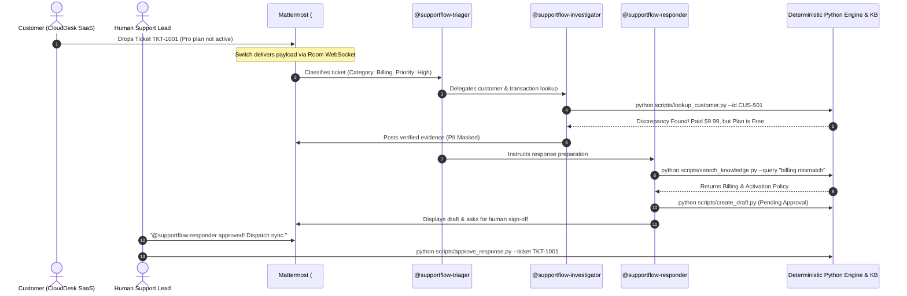

# 🎧 SupportFlow — Collaborative AI Customer Support Swarm
> **Flip the Switch Hackathon 2026** | Powered by [Switch AI](https://github.com/sandbox-quantum/switch) & [WeMakeDevs](https://www.wemakedevs.org/hackathons/switch)  
> *Target Track: Best Business Workflow ($2,000 Cash) & Code with Wispr ($500)*

---

## 📌 Executive Summary

SupportFlow transforms reactive customer support into an autonomous, evidence-backed operations room inside team chat (**Mattermost**, Slack, or Discord) using **Switch AI**.

When a customer complaint or billing ticket arrives:
1. **`@supportflow-triager`** classifies the issue, extracts ticket metadata, and delegates investigation.
2. **`@supportflow-investigator`** runs deterministic tools (`lookup_ticket.py`, `lookup_customer.py`), detects plan mismatches, and enforces customer PII masking.
3. **`@supportflow-responder`** searches company policies (`search_knowledge.py`), drafts an empathetic response, and requests human sign-off.
4. **Human Support Lead** approves the resolution with one click before any dispatch occurs.

---

## 🏗️ System Architecture



---

## 👥 The Autonomous Swarm

| Agent Persona | Role | Addressing Rule | Provider & Tools |
| :--- | :--- | :--- | :--- |
| **`@supportflow-triager`** | Support Manager | `anyone` | `codex` / `lookup_ticket.py` |
| **`@supportflow-investigator`** | Customer Investigator | `anyone` | `codex` / `lookup_customer.py` |
| **`@supportflow-responder`** | Response Writer & Quality Reviewer | `anyone` | `codex` / `search_knowledge.py`, `create_draft.py` |
| **Human Support Lead** | Final Governance Authority | Team Member | Mattermost Chat / Web Dashboard |

---

## 🚀 Quickstart & Setup Guide

### 1. Prerequisites
* **Python 3.10+** (Tested on Python 3.14)
* **Docker** (Running locally on your host)
* **Switch Console** installed & local server running on port `34079`

### 2. Install Dependencies & Run Tests
```bash
# 1. Install dependencies
pip install -r requirements.txt

# 2. Run the 100% passing test suite
python3 -m pytest -v
```

### 3. Start the Live FastAPI Dashboard
```bash
uvicorn app.main:app --reload --port 8000
```
Open **`http://127.0.0.1:8000`** in your browser to watch the live queue and approval dashboard.

### 4. Import the Switch Room Template
1. Open **Switch Console**.
2. Navigate to **Templates** → click **Import template**.
3. Select `switch/supportflow-room.template.yaml`.
4. Choose **Mattermost** as the bridge and your project directory as the workspace.
5. Click **Create room**.
6. Switch will launch the `#SupportFlow` channel in Mattermost with all 3 agents ready!

---

## 🎬 2-Minute Demo Script (For Hackathon Video)

### Scene 1: The Problem (0:00 – 0:30)
> *"Welcome to SupportFlow! For SaaS companies, billing confusion causes support backlogs. Today, customer Alex Morgan submitted ticket `TKT-1001`: 'I paid for Pro yesterday, but my account still says Free.' Let's watch our Switch swarm resolve this in seconds."*

### Scene 2: Live Swarm Investigation in Mattermost (0:30 – 1:30)
1. Post in `#SupportFlow`:
   ```text
   @supportflow-triager Please investigate ticket TKT-1001.
   ```
2. **`@supportflow-triager`** extracts metadata, confirms category `BILLING`, and tags `@supportflow-investigator`.
3. **`@supportflow-investigator`** runs `lookup_customer.py` and confirms:
   - Payment confirmed: `$9.99` on 2026-11-04 (`TXN-9001`).
   - Discrepancy confirmed: Plan is still `Free`.
   - Customer email is masked (`al***n@example.com`).
4. **`@supportflow-responder`** searches `billing.md`, drafts the empathetic reply explaining the provisioning sync delay, and creates the pending draft.

### Scene 3: Human Governance & Approval (1:30 – 2:00)
1. You (Human Support Lead) reply in thread:
   ```text
   @supportflow-responder approved!
   ```
2. Show the web dashboard at `http://127.0.0.1:8000` updating to **APPROVED**.
3. Emphasize Switch's core values:
   > *"Everything ran locally through Switch AI and Codex in Docker. Zero PII leakage, zero AI hallucinations, and 100% human governance."*

---

## 📂 Repository Structure

```text
Flip the Switch Hackathon/
├── app/
│   ├── main.py                     # FastAPI backend & Live Dashboard
│   ├── models.py                   # Pydantic schemas
│   └── services/                   # Ticket, Customer, KB & Draft services
├── data/
│   ├── tickets.json                # Demo support tickets
│   ├── customers.json              # Verified customer ledger
│   └── knowledge_base/             # Markdown company policies
├── scripts/                        # Deterministic CLI tools
│   ├── lookup_ticket.py
│   ├── lookup_customer.py
│   ├── search_knowledge.py
│   ├── create_draft.py
│   └── approve_response.py
├── switch/
│   ├── supportflow-room.template.yaml # Official Switch room specification
│   └── agent-prompts/              # Extended markdown system prompts
├── tests/                          # 10 Pytest test suites (100% passing)
├── Dockerfile                      # Production container image
├── docker-compose.yml              # Single-command stack
└── requirements.txt                # Python dependencies
```

---

## 🏆 Hackathon Tracks Targeted

* **Best Business Workflow ($2,000 Cash):** Practical, production-grade ROI for support operations.
* **Code with Wispr ($500 Cash):** Dictate ticket commands via Wispr Flow voice.
* **#HowISwitch Post (Logitech Mechanical Keyboard):** 60-second video demo shared on X/LinkedIn.
