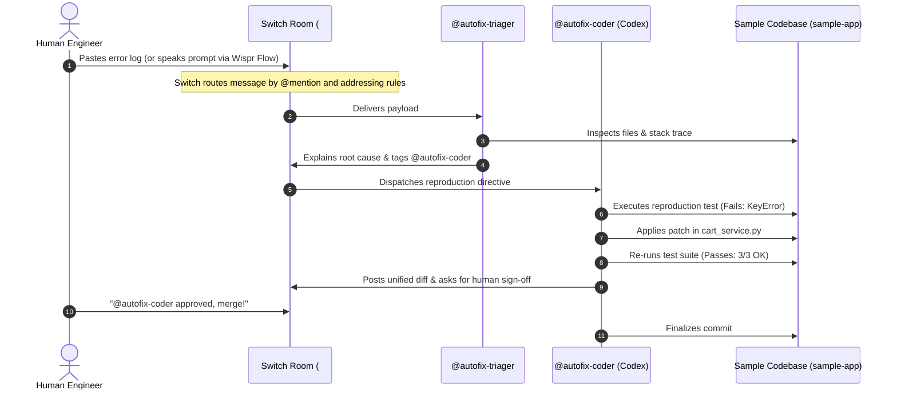

# 🚨 AutoFix Room — Autonomous Incident Triage & Hotfix Swarm
> **Flip the Switch Hackathon 2026** | Powered by [Switch AI](https://github.com/sandbox-quantum/switch) & [WeMakeDevs](https://www.wemakedevs.org/hackathons/switch)  
> *Track Submission: Best Business Workflow ($2,000) & Code with Wispr ($500)*

---

## 📌 Executive Summary

Modern engineering teams spend hours each week manually triaging runtime crashes, digging through git blame logs, and drafting boilerplate hotfixes. 

**AutoFix Room** transforms reactive on-call chaos into an autonomous, collaborative war room inside your team chat (Mattermost, Slack, or Discord) using **Switch AI**. 

When an incident alert or Sentry stack trace hits the channel:
1. **`@Triager`** diagnoses the root cause, maps the error to the source file, and tags the coder.
2. **`@Coder`** writes a reproduction test, applies the code patch, and verifies test execution with exit code 0.
3. **The Human Engineer** reviews the diff and approves deployment directly in the chat thread.

---

## 💡 Market Validation: Grounded in Trending YC Startups

AutoFix Room replicates the high-growth business models of the fastest-scaling **Y Combinator (2024–2026)** developer tool startups:

* **[StarSling](https://www.ycombinator.com/launches/starsling-ai-powered-internal-developer-portal) (YC 2024):** Automatically converts Sentry and GitHub issues into one-click pull requests in Slack.
* **[Gini](https://ginicomputerai.com) ([YC Profile](https://www.ycombinator.com/companies/opentag)):** Digital coworkers living in workplace chat channels to execute engineering tasks in sandboxes.
* **[Linzumi](https://www.ycombinator.com/launches/linzumi-team-chat-for-directing-ai-coding-agents) (YC 2024):** Dedicated team chat designed for directing swarms of AI coding agents with human-in-the-loop governance.
* **[Greptile](https://www.ycombinator.com/companies/greptile) & [Ellipsis](https://www.ycombinator.com/companies/ellipsis) (YC S23/W24):** Multi-million ARR platforms automating codebase QA and Slack-driven bug fixes.
* **#1 Trending Story on Hacker News (836+ pts):** *"AI is forcing us to pay off 40 years of technical debt."* AutoFix Room directly automates the resolution of legacy bugs and regression prevention.

*(Read our full [MARKET_RESEARCH.md](file:///home/bappaditya/coding/Flip%20the%20Switch%20Hackathon/MARKET_RESEARCH.md) for detailed startup teardowns and funding analysis).*

---

## 🏗️ Architecture & Interaction Flow



---

## 👥 The Autonomous Swarm

| Agent Persona | Role | Addressing Rule | Provider |
| :--- | :--- | :--- | :--- |
| **`@autofix-triager`** | Lead Incident Triager | `anyone` | Local Coding Agent / LLM |
| **`@autofix-coder`** | Autonomous Bug Fixer | `owner_and_owner_agents` | `codex` CLI |
| **Human Engineer** | Incident Commander | Team Member | Mattermost / Slack |

---

## 🚀 Quickstart & Setup Guide

### 1. Prerequisites
* **Docker:** Running on your host machine.
* **Switch Console:** Installed (RPM, AppImage, or DMG).
* **AI Coding Agent:** `codex` installed (`codex-cli 0.152.1`).

### 2. Apply the Switch Room Template
1. Open **Switch Console**.
2. Go to **Templates** → click **Import Custom Template** (or create a template from `templates/autofix-room.template.yaml`).
3. Set your team prefix (e.g. `team1`).
4. Click **Create agent and room**.
5. Switch launches the `#team1-autofix` room in your local Mattermost chat!

---

## 🎬 2-Minute Demo Script (For Hackathon Video)

Follow this exact script when recording your submission video with OBS or Loom:

### Phase 1: The Hook (0:00 – 0:30)
> *"Hi everyone! In modern software teams, incident response is broken. An on-call engineer gets paged at 2 AM, spends 45 minutes finding the broken file, manually writes a fix, and waits for morning reviews. With Switch AI, we built **AutoFix Room** — an autonomous multi-agent engineering swarm that turns solo coding agents into collaborative teammates."*

### Phase 2: Live Incident in Mattermost (0:30 – 1:30)
1. Open the `#team1-autofix` channel in Mattermost.
2. Paste the contents of `sample-app/error_trace.log`:
   ```text
   @team1-triager [CRITICAL] 500 Internal Server Error in cart-service:
   KeyError: 'EXPIRED50' in calculate_total (cart_service.py line 34).
   14 checkouts aborted!
   ```
3. Watch **`@team1-triager`** reply in the thread, explaining that invalid coupons cause unhandled dictionary lookups.
4. `@team1-triager` tags **`@team1-coder`**.
5. `@team1-coder` executes the reproduction test, applies the `.get(coupon_code, 0.0)` fix in `sample-app/cart_service.py`, confirms all unit tests pass, and displays the clean diff.

### Phase 3: Human-in-the-Loop Sign-off (1:30 – 2:00)
1. You (Human Engineer) reply in thread:
   ```text
   @team1-coder verified and approved. Merge to staging!
   ```
2. Explain the architecture:
   > *"Everything you saw ran locally using Docker, Switch Core, and local Codex. Code never left our machine. This solves technical debt instantly, reduces MTTR to seconds, and maintains 100% human oversight."*

---

## 📂 Repository Structure

```text
Flip the Switch Hackathon/
├── MARKET_RESEARCH.md            # YC startup precedent & market validation
├── README.md                     # Project overview & demo walkthrough
├── templates/
│   └── autofix-room.template.yaml# Official Switch Room specification
└── sample-app/
    ├── cart_service.py           # Target service with simulated edge-case bug
    ├── test_cart.py              # Reproduction and regression test suite
    └── error_trace.log           # Realistic production incident log
```

---

## 🏆 Hackathon Tracks Targeted

* **Best Business Workflow ($2,000 Cash):** Practical, production-grade ROI for engineering and on-call teams.
* **Code with Wispr ($500 Cash):** Dictate incident commands and bug descriptions by voice into chat.
* **Best Blog (AirPods 5):** Technical walkthrough based on `MARKET_RESEARCH.md`.
* **#HowISwitch Post (Logitech Mechanical Keyboard):** 60-second video demo shared on X/LinkedIn.

