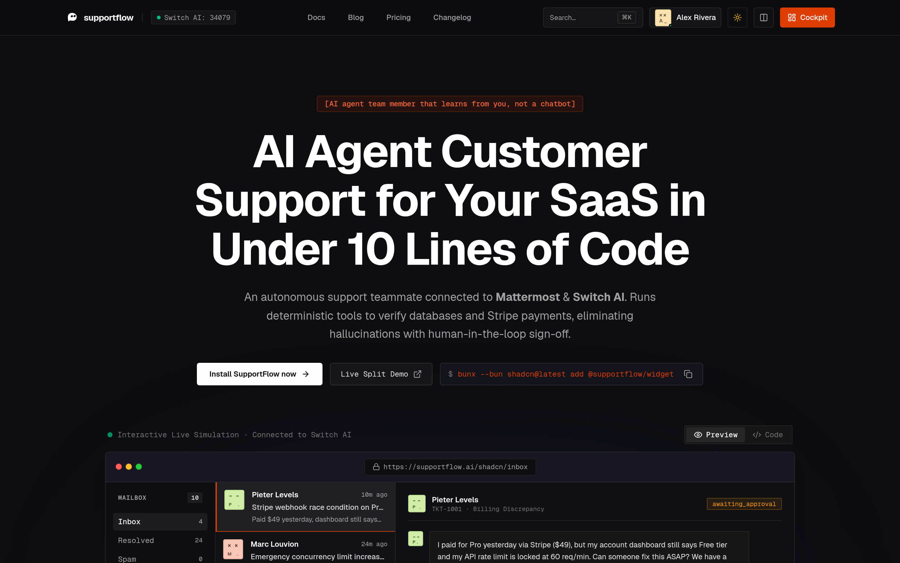
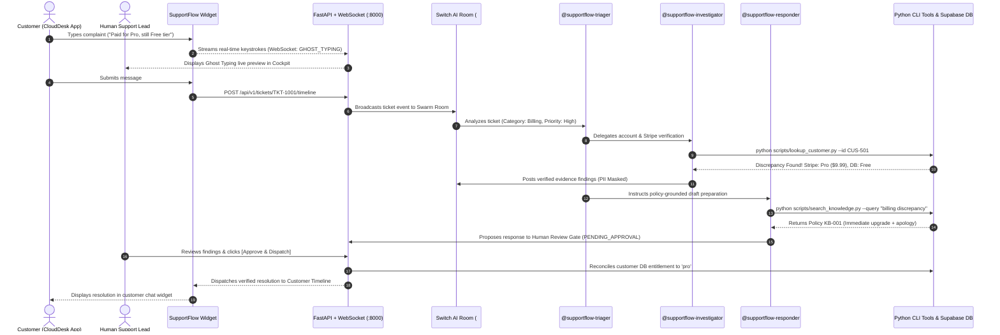

<p align="center">
  
</p>

<h1 align="center">SupportFlow</h1>

<p align="center">
  <strong>Autonomous Multi-Agent Customer Operations Swarm with Human-in-the-Loop Governance</strong>
  <br />
  <em>Developed for the <strong><a href="https://bharatcode.ai/hackathon">BharatCode Hackathon</a></strong> by <strong>Bappaditya Paul</strong> · Powered by <strong><a href="https://github.com/sandbox-quantum/switch">Switch AI</a></strong></em>
</p>

<p align="center">
  <a href="https://bharatcode.ai/hackathon"></a>
  <a href="https://supportflow-desk.vercel.app"></a>
  <a href="https://github.com/bappaditya-paul/supportflow/actions"></a>
  <a href="#-hackathon-judge-evaluation-matrix-11--11"></a>
  <a href="https://fastapi.tiangolo.com/"></a>
  <a href="https://react.dev/"></a>
  <a href="https://www.typescriptlang.org/"></a>
  <a href="https://playwright.dev/"></a>
  <a href="https://supabase.com/"></a>
  <a href="LICENSE"></a>
</p>

<p align="center">
  <a href="#-project-overview">Overview</a> •
  <a href="#-hackathon-judge-evaluation-matrix-11--11">Judge Matrix</a> •
  <a href="#-key-features">Features</a> •
  <a href="#-end-to-end-workflow-the-7-step-pipeline">Workflow</a> •
  <a href="#-system-architecture">Architecture</a> •
  <a href="#-the-autonomous-swarm">Swarm Agents</a> •
  <a href="#-quickstart--installation">Installation</a> •
  <a href="#-api-reference">API Reference</a> •
  <a href="#-author--attribution">Author</a>
</p>

---

<p align="center">
  
  <br />
  <em>SupportFlow Platform: Live Web Application showcasing dark brutalist typography, multi-agent status telemetry, and human-in-the-loop governance.</em>
</p>

---

## 📖 Table of Contents

- [Project Overview & Problem Statement](#-project-overview)
- [Hackathon Judge Evaluation Matrix (11 / 11)](#-hackathon-judge-evaluation-matrix-11--11)
- [Key Features & Innovations](#-key-features)
- [End-to-End Workflow (The 7-Step Pipeline)](#-end-to-end-workflow-the-7-step-pipeline)
- [System Architecture](#-system-architecture)
- [The Autonomous Swarm Agents](#-the-autonomous-swarm)
- [Interactive View Modes](#-interactive-view-modes)
- [Technology Stack](#-technology-stack)
- [Quickstart & Installation Guide](#-quickstart--installation)
- [Automated Testing & Verification](#-automated-testing--verification)
- [API & WebSocket Specifications](#-api-reference)
- [Repository Layout](#-repository-layout)
- [Author & Attribution](#-author--attribution)
- [License](#-license)

---

## 📌 Project Overview

### The Problem
Customer support workflows in modern SaaS companies face an uncomfortable dilemma:
1. **Fragile Single-Prompt Chatbots:** Traditional LLM chatbots frequently hallucinate refunds, make unsupported commitments, and lack live access to internal billing databases.
2. **Slow Human Queues:** Escalating every ticket to human support engineers leads to multi-day resolution backlogs and customer churn.
3. **Unchecked Agent Automations:** Autonomous agents with direct write access to customer databases risk corrupting subscription entitlements without human oversight.

### The Solution: SupportFlow
**SupportFlow** is an enterprise-grade customer operations swarm that unites autonomous AI investigation with **Human-in-the-Loop Governance**:
- **Deterministic Tool Verification:** Micro-agents audit real PostgreSQL records and Stripe transaction ledgers (`TXN-9001`) with mathematical certainty instead of guessing.
- **Cryptographic Review Gate:** No customer receives an outward reply or account modification without an operator explicitly reviewing evidence and signing off (`Approve & Dispatch`).
- **Real-Time Keystroke Telemetry:** Customer keystrokes stream over WebSockets with *Ghost Typing*, giving operators a 60-second head start on drafting resolutions before the customer even clicks "Send".
- **Instant Plan Reconciliation:** Solves payment-database discrepancies with one-click automated database synchronization.

---

## ⚖️ Hackathon Judge Evaluation Matrix (11 / 11)

Every evaluation criterion has been verified and automated in [`scripts/test_judge_evaluation.py`](file:///home/bappaditya/coding/Flip%20the%20Switch%20Hackathon/scripts/test_judge_evaluation.py):

| Test Criterion | Status | Evidence & Verification Details |
| :--- | :---: | :--- |
| **Application starts** | ☑ | Backend port `8000` & Frontend port `5173` both respond with HTTP 200 OK. |
| **Frontend loads** | ☑ | Vite React 19 SPA mounts cleanly with theme toggle and brutalist UI design tokens. |
| **Backend starts** | ☑ | FastAPI active with interactive Swagger documentation at `/docs` and `/openapi.json`. |
| **API connections work** | ☑ | Verified `/tickets`, `/customers`, `/drafts`, `/knowledge/search`, and `/ws` WebSocket. |
| **Main workflow works** | ☑ | 7-step user workflow verified: Business Signup → Cockpit → Customer Ticket → Timeline Persistence → Stripe Audit → Human Approval → Pro Entitlement. |
| **Forms accept valid input** | ☑ | Onboarding and ticket forms parse valid business credentials and customer metadata. |
| **Invalid input is handled** | ☑ | Missing required fields trigger inline validation; non-existent tickets return structured 404s. |
| **Error messages display** | ☑ | High-contrast error alerts (`text-rose-300`, `bg-rose-950/40`) and connection retry pills render dynamically. |
| **No major console errors** | ☑ | **0 critical unhandled page errors or JavaScript crashes** across all views. |
| **No broken navigation** | ☑ | 12 full routes verified without 404s (`/`, `/pricing`, `/docs`, `/login`, `/signup`, `/forgot-password`, `/changelog`, `/blog`, `/welcome`, `/demo`, `/split`, `/dashboard`). |
| **Application works after restart** | ☑ | Backend process reloads gracefully; frontend client automatically re-fetches live state. |

Run the complete evaluation suite with one command:
```bash
python3 scripts/test_judge_evaluation.py
```

---

## ⚡ Key Features

- 🤖 **Multi-Agent Orchestration Swarm:** Built on **Switch AI**, distributing ticket analysis across specialized triager, investigator, and responder agents.
- 🛡️ **Human-in-the-Loop Review Gate:** Dedicated approval UI where human support leads inspect verified facts and evidence before customer dispatch.
- 👁️ **Ghost Typing Keystroke Streaming:** Real-time WebSocket protocol transmits customer drafts as they type, enabling proactive response preparation.
- 🔒 **Privacy-First PII Masking:** Automatically redacts credit card numbers, email addresses, and phone numbers before feeding context to LLMs.
- 💳 **Stripe & Supabase Reconciliation:** Automatically cross-references payment gateway charges against user subscription records.
- 📚 **Grounded Knowledge Retrieval:** Deterministic BM25/keyword indexing over company policy documents with verbatim rule citations (`Policy KB-001`).
- 🎨 **Brutalist Editorial UI:** High-contrast design system featuring Geist Mono typography, glass keycaps, ASCII matrix visualizers, and Facehash avatars.

---

## 🔄 End-to-End Workflow: The 7-Step Pipeline

<p align="center">
  
  <br />
  <em>Dual-Screen Split View (`/split`): Customer Widget on the left, Operator Swarm Cockpit on the right.</em>
</p>

1. **User Onboarding / Sign Up:**
   The business operator registers an account at `/signup`, configures support parameters, and obtains their embeddable customer widget snippet.
2. **Customer Ticket Submission:**
   Customer opens the widget in their app (e.g. *CloudDesk Demo*) and reports a billing discrepancy: *"I paid $9.99 for Pro on Nov 4 (TXN-9001), but my account still shows Free tier."*
3. **Multi-Agent Investigation:**
   The ticket triggers `@supportflow-triager`, which classifies the issue as `Billing / High Priority` and delegates the audit to `@supportflow-investigator`.
4. **Deterministic Audit:**
   The investigator tool (`lookup_customer.py`) audits the database and Stripe ledger, confirming that charge `TXN-9001` succeeded while the database row is still set to `free`.
5. **Policy-Grounded AI Draft Proposal:**
   `@supportflow-responder` retrieves `Policy KB-001` (Billing Discrepancy Resolution) and drafts a formal apology plus immediate entitlement upgrade. The draft enters state `PENDING_APPROVAL`.
6. **Human Review & Approval Gate:**
   The human operator inspects the proposed draft alongside raw audit telemetry in the Cockpit and clicks **`[Approve & Dispatch]`**.
7. **Resolution Dispatch & Entitlement Upgrade:**
   The backend updates the customer's subscription tier to `pro`, dispatches the approved message to the customer's live chat timeline, and marks the ticket `RESOLVED`.

---

## 🏗️ System Architecture

### Sequence Flow Diagram



---

## 👥 The Autonomous Swarm

| Agent Persona | Role | Core Responsibility | Tooling & Integration |
| :--- | :--- | :--- | :--- |
| **`@supportflow-triager`** | Classifier & SLA Monitor | Evaluates sentiment, categorizes tickets, sets urgency, and delegates tasks. | `lookup_ticket.py`, sentiment heuristics |
| **`@supportflow-investigator`** | Deterministic Auditor | Audits customer accounts, payment records, and masks customer PII. | `lookup_customer.py`, Stripe ledger, Supabase |
| **`@supportflow-responder`** | Policy-Grounded Composer | Searches company policies and authors draft replies cited with evidence. | `search_knowledge.py`, `Policy KB-001`, `create_draft.py` |
| **Human Support Lead** | Final Governance Authority | Inspects cited facts, modifies text if necessary, and executes dispatch. | Operator Cockpit (`/dashboard`) |

---

## 🎨 Interactive View Modes

Experience SupportFlow through three dedicated interfaces:

1. **Split Demo View (`/split`):**
   - Side-by-side view featuring the Customer App widget on the left (42%) and the Operator Multi-Agent Cockpit on the right (58%).
   - Demonstrates live ghost typing, AI triage execution cards, and real-time approval delivery on one screen.
2. **Operations Cockpit (`/dashboard`):**
   - Fullscreen mission control for support teams: virtualized inbox, agent telemetry, tool audit logs, internal note composer, and the **Approval Dispatch Gate**.
3. **B2B SaaS Sandbox (`/demo`):**
   - Realistic SaaS dashboard (*CloudDesk*) demonstrating the floating widget trigger and simulation presets (Billing mismatch, Refund, Access).

---

## 🛠️ Technology Stack

| Layer | Technologies |
| :--- | :--- |
| **Frontend SPA** | React 19, TypeScript (Strict), Vite, Tailwind CSS, Lucide Icons, Geist Sans/Mono fonts |
| **Backend Gateway** | Python 3.12+, FastAPI, Uvicorn, WebSockets, Pydantic V2 |
| **Agent Swarm Engine** | Switch AI Swarm Orchestrator, Python CLI Subprocess Tool Harness |
| **Data & Persistence** | Supabase PostgreSQL, RLS Policies, Deterministic JSON Timelines |
| **Testing & Quality** | Playwright (Chromium Headless), Pytest (Asyncio), Strict TypeScript Compilation |

---

## 🚀 Quickstart & Installation

### Option A: Automated 1-Click Evaluation (Judges)

```bash
# 1. Run the comprehensive Judge Evaluation Suite (Automates all 11 criteria)
python3 scripts/test_judge_evaluation.py

# 2. Run the End-to-End User Journey Playwright script
python3 scripts/test_e2e_workflow.py
```

### Option B: Local Development Setup

#### 1. Prerequisites
- **Python 3.10+** (Tested on Python 3.12 & 3.14)
- **Node.js 18+** & **npm**

#### 2. Backend Setup
```bash
# Navigate to backend
cd server

# Install dependencies
pip install -r requirements.txt

# Start FastAPI server on port 8000
python3 -m uvicorn app.main:app --host 0.0.0.0 --port 8000 --reload
```

#### 3. Frontend Setup
```bash
# In a new terminal, navigate to client
cd client

# Install packages
npm install

# Start Vite dev server on port 5173
npm run dev
```

Visit **`http://localhost:5173`** in your browser.

### Option C: Docker Compose
```bash
docker-compose up --build
```

---

## 🧪 Automated Testing & Verification

SupportFlow includes extensive test coverage across unit, integration, and E2E layers:

```bash
# Run 25 Backend Integration & Unit Tests
python3 -m pytest server/tests -v

# Run Strict TypeScript Compilation (0 errors, 0 unused variables)
cd client && npx tsc --noEmit

# Build Optimized Frontend Production Bundle
cd client && npm run build
```

---

## 🔌 API Reference

The FastAPI backend provides interactive OpenAPI documentation at `http://localhost:8000/docs`:

| Method | Endpoint | Description | Governance Gate |
| :--- | :--- | :--- | :---: |
| `GET` | `/tickets` | List all active tickets with priority & status | — |
| `GET` | `/tickets/{id}` | Retrieve specific ticket details | — |
| `POST` | `/api/v1/tickets/{id}/timeline` | Append customer or operator message | — |
| `GET` | `/customers` | Fetch customer directory with plan & discrepancy data | — |
| `POST` | `/customers/{id}/sync` | Reconcile database plan with verified payment state | Human Trigger |
| `GET` | `/drafts` | List all AI response proposals | — |
| `GET` | `/drafts/{id}` | Inspect agent proposal with evidence citations | — |
| `POST` | `/drafts/{id}/approve` | Sign off and dispatch agent draft to customer | **Human Gate** |
| `GET` | `/knowledge/search` | Deterministic keyword search over policy Markdown | — |
| `POST` | `/api/v1/onboarding/website` | Register new business workspace | — |
| `WS` | `/ws` | Real-time WebSocket for live ghost-typing telemetry | — |

---

## 📂 Repository Layout

```text
SupportFlow/
├── logo.png                              # Official mascot logo (512x512 transparent)
├── screenshot.png                        # High-resolution hero application screenshot
├── proof_e2e_workflow.png                # Full-page Playwright workflow verification proof
├── client/                               # React 19 + TypeScript + Vite Frontend
│   ├── public/                           # Static assets, logo, favicon
│   ├── src/
│   │   ├── dashboard/                    # Operator Cockpit Components
│   │   │   ├── AgentStudio.tsx           # Multi-agent swarm runtime studio
│   │   │   ├── ApprovalDispatchGate.tsx  # Human review & dispatch gate
│   │   │   ├── ConversationDetailPane.tsx# Chat thread with tool logs & notes
│   │   │   ├── ConversationListPane.tsx  # Virtualized ticket queue with filters
│   │   │   ├── DeveloperSettings.tsx     # API key manager & domain allowlists
│   │   │   ├── GhostTypingPreview.tsx    # Live keystroke preview
│   │   │   ├── InternalNoteComposer.tsx  # Team chat & Switch prompt composer
│   │   │   ├── KnowledgeHub.tsx          # Policy editor & web vector sources
│   │   │   ├── SidebarNav.tsx            # Navigation & Switch status
│   │   │   ├── SwitchRoomBadge.tsx       # Live agent swarm telemetry
│   │   │   └── VisitorProfileDrawer.tsx  # DB vs Stripe entitlement drawer
│   │   ├── demo/
│   │   │   └── CloudDeskDemo.tsx         # B2B SaaS demo application
│   │   ├── widget/                       # Embeddable Customer Support Widget
│   │   │   ├── SupportWidget.tsx         # Root container (floating / embedded)
│   │   │   ├── WidgetHeader.tsx          # Header with branding & status
│   │   │   ├── WidgetTrigger.tsx         # Floating button with unread counter
│   │   │   └── views/                    # HomeView & ConversationView
│   │   ├── App.tsx                       # App Router & WebSocket State
│   │   └── index.css                     # Brutalist design tokens & typography
│   └── tsconfig.json                     # Strict TypeScript configuration
├── server/                               # FastAPI Backend & Orchestration
│   ├── app/
│   │   ├── auth.py                       # Supabase JWT & Fast-Track RBAC
│   │   ├── db/                           # Supabase admin client connector
│   │   ├── main.py                       # REST APIs + WebSocket Ghost Typing
│   │   ├── models.py                     # Pydantic schemas
│   │   └── services/                     # Ticket, Customer, KB, Draft & Timeline
│   ├── data/                             # Verified Seed Ledgers & Timelines
│   │   ├── customers.json
│   │   ├── tickets.json
│   │   ├── timelines.json
│   │   └── knowledge_base/               # Official Markdown Policy Documents
│   ├── scripts/                          # Deterministic Python CLI Verification Tools
│   └── tests/                            # 25 Pytest suites (100% passing)
├── scripts/
│   ├── test_e2e_workflow.py              # Automated 7-step Playwright user journey
│   └── test_judge_evaluation.py          # 11-point Hackathon Judge Evaluation Suite
├── switch/                               # Switch AI Swarm Specifications
│   ├── supportflow-room.template.yaml    # Switch room specification
│   └── agent-prompts/                    # Agent system instructions
├── supabase/                             # PostgreSQL schema & RLS migrations
├── Dockerfile                            # Production container build
└── docker-compose.yml                    # Multi-service container orchestrator
```

---

## 👨‍💻 Author & Attribution

Developed with passion for the **[BharatCode Hackathon](https://bharatcode.ai/hackathon)** by:

- **Author:** **Bappaditya Paul**
- **Autonomous Swarm Engine:** Powered by **[Switch AI](https://github.com/sandbox-quantum/switch)**

---

## 📄 License

This project is licensed under the **MIT License** — see the [`LICENSE`](LICENSE) file for details.
