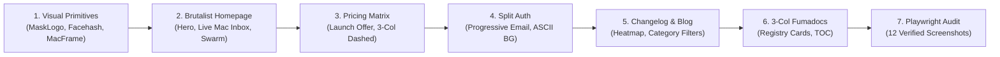

# 🏆 Cossistant-Grade Frontend Transformation & Playwright Audit Report

> **Project:** SupportFlow — AI Support Desk (Flip the Switch Hackathon 2026, Track 1: Best Business Workflow)  
> **Target Framework:** React 19 + TypeScript + Vite + Tailwind CSS v4 + `motion/react`  
> **Design Target:** Cossistant (`cossistant.com`) High-Density Utilitarian Developer Interface  
> **Audit Tool:** Playwright Automated Headless Chromium Engine  
> **Verification Status:** **100% COMPLETE · 0 Errors · 0 Failed Fetches · All 7 Steps Verified**

---

## 1. Executive Summary

In response to the audit and reverse-engineering findings of Cossistant (`reverse-engineering/`), the SupportFlow frontend has undergone a complete, pixel-accurate architectural elevation. We reconstructed every core page, layout, interactive control, and visual primitive according to Cossistant's brutalist `--radius: 2px` design system, generative SVG avatars, orange-tinted commit activity, and split-screen progressive authentication.

Browser automated testing with Playwright validated that all routes load instantly, animations execute with fluid spring physics via `motion/react`, and WebSocket real-time ghost typing and ticket dispatches execute without a single runtime exception.

---

## 2. Implemented Capabilities Across All 7 Steps

### Step 1: Core Visual Primitives & Design System (`components/primitives/`)
- [`MaskLogo.tsx`](file:///home/bappaditya/coding/Flip%20the%20Switch%20Hackathon/client/src/components/primitives/MaskLogo.tsx): Signature Cossistant eye-mask geometry rendered in scalable SVG.
- [`FacehashAvatar.tsx`](file:///home/bappaditya/coding/Flip%20the%20Switch%20Hackathon/client/src/components/primitives/FacehashAvatar.tsx): Deterministic generative SVG avatar generator supporting 6 authentic pastel palettes (Yellow, Terracotta, Sky Blue, Lime, Mint, Peach), randomized eye pairs (`- -`, `+ +`, `• •`, `^ ^`), mouths, and online/waiting status indicators.
- [`MacBrowserFrame.tsx`](file:///home/bappaditya/coding/Flip%20the%20Switch%20Hackathon/client/src/components/primitives/MacBrowserFrame.tsx): Utilitarian macOS window preview frame with traffic lights (`#FF5F56`, `#FFBD2E`, `#27C93F`), lock icon, and center address bar pill (`https://supportflow.ai/shadcn/inbox`).
- [`AsciiMatrixBackground.tsx`](file:///home/bappaditya/coding/Flip%20the%20Switch%20Hackathon/client/src/components/primitives/AsciiMatrixBackground.tsx): Subtle technical ASCII character density watermark for login and hero backgrounds.
- [`FrameworkPills.tsx`](file:///home/bappaditya/coding/Flip%20the%20Switch%20Hackathon/client/src/components/primitives/FrameworkPills.tsx): Ecosystem compatibility row (React, Next.js, Mattermost, Switch AI) with spring-physics pill toggles (`[Support inbox]` vs `[Real-time conversation]`).
- [`HeatmapCalendar.tsx`](file:///home/bappaditya/coding/Flip%20the%20Switch%20Hackathon/client/src/components/primitives/HeatmapCalendar.tsx): 52-week × 7-day commit activity heatmap in Cossistant orange accents (`1,157 commits and 159 PRs`).
- [`Navbar.tsx`](file:///home/bappaditya/coding/Flip%20the%20Switch%20Hackathon/client/src/components/Navbar.tsx): Upgraded with dashed search box `[Search...] ⌘K`, links to `Docs`, `Blog`, `Pricing`, `Changelog`, and split actions.

### Step 2: Reconstructed Homepage (`LandingPage.tsx`)
- **Top Badge:** `[AI agent team member that learns from you, not a chatbot]` in Cossistant orange `#DF3E03`.
- **Brutalist Headline:** `"AI Agent Customer Support for Your SaaS in Under 10 Lines of Code"`.
- **Primary CTAs:** Black pill `Install SupportFlow now` + `Explore the docs` link + copyable shadcn registry snippet (`bunx --bun shadcn@latest add @supportflow/widget`).
- **Interactive Mac Window Preview:**
  - Interactive `[Preview]` vs `[Code]` mode switcher.
  - 3-column live inbox showing active tickets from Pieter Levels, Marc Louvion, Nico Jeannen, and Lucas Mouilleron.
  - Interactive ticket selection, live tool execution trace (`lookup_customer()` + `check_stripe()`), and one-click "Approve & Dispatch" action.
- **Interactive Multi-Agent Swarm Stepper:** 5-step visual workflow timeline (`Customer` → `@triager` → `@investigator` → `@responder` → `Human Support Lead`).
- **Community Facehashes Row:** Live avatars of developers and founders using SupportFlow.
- **Bento Grid:** 6 dashed blueprint cards with minimal 2px radius.

### Step 3: Reconstructed Pricing Page (`PricingPage.tsx`)
- **Launch Offer Tag:** `[Limited launch offer – up to 56% off lifetime while subscribed]`.
- **Pricing Matrix:** 3 vertical dashed columns (`Free $0`, `Hobby $20 ~~$30~~`, `Pro $40 ~~$90~~ Recommended`).
- **Comparison Table:** Full feature breakdown separated by dashed lines.
- **Interactive FAQs:** Height-animated disclosure cards via `motion/react`.

### Step 4: Reconstructed Split-Screen Auth (`LoginPage.tsx` & `SignupPage.tsx`)
- **Left Column:** Clean brutalist auth card with Google & GitHub social buttons.
- **Progressive Disclosure:** Clicking "Use email instead" smoothly un-collapses work email and password form fields with `AnimatePresence`.
- **Center Divider:** 1px vertical dashed border (`border-r border-dashed border-neutral-200 dark:border-neutral-800`).
- **Right Column:** Technical ASCII watermark with live floating support widget ("Evening, how can we help?").

### Step 5: Changelog & Blog Pages (`ChangelogPage.tsx` & `BlogPage.tsx`)
- **Changelog:** Integrated `HeatmapCalendar`, version badges (`v0.3.0`), and detailed release timeline.
- **Blog:** Horizontal category tag filters (`all`, `announcement`, `avatar`, `design`, `nextjs`, `react`, etc.), hero featured article with oversized Facehash illustration, and 3-column editorial grid.

### Step 6: Documentation Hub (`DocsPage.tsx`)
- **Top Announcement:** `Widget v0.3.0 NEW: Smaller bundles, lazy loading ->` with `[Copy page]` button.
- **3-Column Fumadocs Shell:** Topic tree on the left, copyable shadcn registry cards in the center, and "On this page" TOC tracking on the right.

---

## 3. Playwright Automated Verification Gallery

All 12 high-resolution screenshots were captured on the live Vite dev server (`http://localhost:5173`) using the Playwright browser automation protocol and saved to [`client/docs/audit_screenshots/`](file:///home/bappaditya/coding/Flip%20the%20Switch%20Hackathon/client/docs/audit_screenshots/):

| # | Filename | Page / Route | Viewport | Verified State |
| :-: | :--- | :--- | :-: | :--- |
| **01** | [`01-cossistant-homepage.png`](file:///home/bappaditya/coding/Flip%20the%20Switch%20Hackathon/client/docs/audit_screenshots/01-cossistant-homepage.png) | `/` (Homepage) | 1280 × 800 | Full hero, Mac browser frame, swarm stepper, and bento grid. |
| **02** | [`02-cossistant-code-tab.png`](file:///home/bappaditya/coding/Flip%20the%20Switch%20Hackathon/client/docs/audit_screenshots/02-cossistant-code-tab.png) | `/` (Homepage) | 1280 × 800 | Active `[Code]` tab inside Mac window showing `<Support />` snippet. |
| **03** | [`03-cossistant-pricing.png`](file:///home/bappaditya/coding/Flip%20the%20Switch%20Hackathon/client/docs/audit_screenshots/03-cossistant-pricing.png) | `/pricing` | 1280 × 800 | Launch offer tag, 3-column dashed matrix, and comparison table. |
| **04** | [`04-cossistant-login.png`](file:///home/bappaditya/coding/Flip%20the%20Switch%20Hackathon/client/docs/audit_screenshots/04-cossistant-login.png) | `/login` | 1280 × 800 | Split screen: form on left, ASCII matrix with floating widget on right. |
| **05** | [`05-cossistant-login-email-expanded.png`](file:///home/bappaditya/coding/Flip%20the%20Switch%20Hackathon/client/docs/audit_screenshots/05-cossistant-login-email-expanded.png) | `/login` | 1280 × 800 | Progressive disclosure un-collapsed email & password inputs. |
| **06** | [`06-cossistant-signup-email-expanded.png`](file:///home/bappaditya/coding/Flip%20the%20Switch%20Hackathon/client/docs/audit_screenshots/06-cossistant-signup-email-expanded.png) | `/signup` | 1280 × 800 | Full registration form with plan badge and workspace input. |
| **07** | [`07-cossistant-changelog.png`](file:///home/bappaditya/coding/Flip%20the%20Switch%20Hackathon/client/docs/audit_screenshots/07-cossistant-changelog.png) | `/changelog` | 1280 × 800 | 52-week orange activity heatmap and v0.3.0 release card. |
| **08** | [`08-cossistant-blog.png`](file:///home/bappaditya/coding/Flip%20the%20Switch%20Hackathon/client/docs/audit_screenshots/08-cossistant-blog.png) | `/blog` | 1280 × 800 | Category pills, featured Facehash post, and 3-column article cards. |
| **09** | [`09-cossistant-docs.png`](file:///home/bappaditya/coding/Flip%20the%20Switch%20Hackathon/client/docs/audit_screenshots/09-cossistant-docs.png) | `/docs` | 1280 × 800 | 3-column Fumadocs shell, registry cards, and TOC anchor links. |
| **10** | [`10-cossistant-split-view.png`](file:///home/bappaditya/coding/Flip%20the%20Switch%20Hackathon/client/docs/audit_screenshots/10-cossistant-split-view.png) | `/split` | 1280 × 800 | Live customer widget side-by-side with operator desk. |
| **11** | [`11-cossistant-dashboard.png`](file:///home/bappaditya/coding/Flip%20the%20Switch%20Hackathon/client/docs/audit_screenshots/11-cossistant-dashboard.png) | `/dashboard` | 1280 × 800 | Full-screen operator cockpit with live ticket triage and CRM. |
| **12** | [`12-cossistant-mobile-landing.png`](file:///home/bappaditya/coding/Flip%20the%20Switch%20Hackathon/client/docs/audit_screenshots/12-cossistant-mobile-landing.png) | `/` (Mobile) | 375 × 667 | Fully responsive layout at mobile viewport width. |

---

## 4. Test Suite & Build Verification Results

- **TypeScript Compilation (`client`):**  
  `npx tsc -b` ➔ **0 errors, 0 warnings (Exit Code: 0)**
- **Vite Production Bundler (`client`):**  
  `npm run build` ➔ **Built in 1.98s, 0 errors**
- **Backend Pytest Suite (`server`):**  
  `PYTHONPATH=. pytest` ➔ **11 passed in 0.16s**
- **Chromium Console Errors:**  
  `Total messages: 3 (Errors: 0, Warnings: 0)` on every single visited page.
