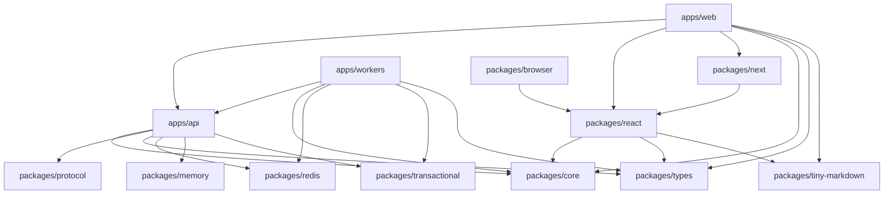

# 02 — Complete Repository Discovery & Monorepo Topology

## 1. Monorepo Organization & Architecture

Cossistant is structured as a **Turborepo monorepo** managed with **Bun 1.3** and formatted with **Biome**.

```
cossistant/
├── apps/
│   ├── api/                   # Main Hono + tRPC backend API server
│   ├── web/                   # Next.js 16 Dashboard, docs, and public site
│   ├── workers/               # BullMQ background workers & job schedulers
│   ├── geoip/                 # Python FastAPI MaxMind GeoIP microservice
│   └── facehash-landing/      # Standalone landing page for Facehash avatars
├── packages/
│   ├── react/                 # Core embeddable React customer support widget
│   ├── next/                  # Next.js wrapper and convenience provider
│   ├── browser/               # Standalone vanilla JS embed script (<script src="...">)
│   ├── core/                  # Shared client/runtime core, state store, & utils
│   ├── memory/                # Vector store, embeddings, and similarity retrieval
│   ├── protocol/              # OpenAPI definitions, HTTP route schemas, REST specs
│   ├── redis/                 # Distributed Redis client and caching wrappers
│   ├── transactional/         # Email templates and delivery via Resend/React Email
│   ├── tiny-markdown/         # Zero-dep lightweight markdown parser
│   ├── types/                 # Shared TypeScript types, Zod schemas, & event contracts
│   ├── typescript-config/     # Base, React, and Next.js tsconfig presets
│   └── release/               # Automated release & publishing CLI tooling
├── tinybird/                  # ClickHouse analytical pipes, data sources, and endpoints
├── examples/
│   ├── react-vite/            # Integration sample using Vite + React
│   └── nextjs-tailwind/       # Integration sample using Next.js App Router + Tailwind
└── infra/                     # AWS SES and S3 infrastructure deployment setup
```

---

## 2. Comprehensive Application Breakdown

### `apps/api` (The Core Engine)
* **Framework:** Hono (`^4.12.32`) on Bun runtime with native WebSocket support (`hono/bun`).
* **Routing Strategy:** Dual-layer architecture:
  * **tRPC Server (`apps/api/src/trpc`):** Type-safe procedures powering the internal Next.js dashboard (`apps/web`). Mounted on `/trpc`.
  * **REST / OpenAPI Endpoints (`apps/api/src/routes`):** Public-facing endpoints for the embeddable chat widget, SDKs, and external integrations (`/api/v1/support`, `/api/v1/conversations`, `/api/v1/visitors`).
* **Realtime Server (`apps/api/src/ws`):** Custom WebSocket server implementing Bun's `ServerWebSocket`, handling visitor connections, agent presence, typing indicators, and timeline streaming.
* **Database Access:** Drizzle ORM (`^0.45.2`) connecting to PostgreSQL 17 with `pgvector`.
* **AI Orchestration:** Vercel AI SDK 6 with OpenRouter and OpenAI providers.

### `apps/web` (The Unified Frontend)
* **Framework:** Next.js 16 (`^16.2.3`) App Router with React 19.
* **Route Groups:**
  * `(lander-docs)`: Public landing page, documentation (powered by `fumadocs`), pricing, terms, blog, and authentication pages (`/login`, `/sign-up`).
  * `(dashboard)/[websiteSlug]`: The operational support workspace. Multi-tenant workspace scoped by `websiteSlug`, containing:
    * `/inbox`: Multi-pane conversation manager.
    * `/contacts`: CRM directory of identified visitors and customer profiles.
    * `/agent`: AI agent personality, system prompt, knowledge training, tool integrations, and thinking budgets.
    * `/settings`: Organization preferences, team member invitations, API keys, allowed domains, and Polar billing.
* **UI Foundation:** Tailwind CSS v4, Radix UI primitives, Lucide icons, TipTap rich text, and Sonner notifications.

### `apps/workers` (Background Processing)
* **Framework:** BullMQ (`^5.34.8`) + Redis + Hono dashboard server.
* **Job Queues:**
  * `ai-agent`: Primary real-time LLM execution loop for incoming customer turns.
  * `ai-agent-background`: Delayed 30-second debounced triage queue (sentiment analysis, title generation, knowledge gap flagging).
  * `email-notifications`: Transports customer and agent notification emails via Resend or AWS SES.
  * `webhooks`: Outbound webhook delivery with retries and signature headers.

### `apps/geoip` (Geolocation Microservice)
* **Framework:** Python 3.12 + FastAPI + MaxMind GeoLite2.
* **Responsibility:** Resolves visitor IP addresses to city, country, postal code, ASN, and organization to enrich visitor profiles in real time.

---

## 3. Package Dependency Map



---

## 4. Environment Variables Specification

The platform utilizes a structured configuration matrix defined in `.env.default`:

| Variable Category | Environment Variables | Purpose |
| :--- | :--- | :--- |
| **Database** | `DATABASE_HOST`, `DATABASE_PORT`, `DATABASE_USERNAME`, `DATABASE_PASSWORD`, `DATABASE_NAME` | Connection details for PostgreSQL 17 + pgvector. |
| **Authentication** | `BETTER_AUTH_SECRET`, `BETTER_AUTH_URL`, `API_KEY_SECRET` | Session hashing, cookie encryption, and API key salting. |
| **OAuth Providers** | `GOOGLE_CLIENT_ID`, `GOOGLE_CLIENT_SECRET`, `GITHUB_CLIENT_ID`, `GITHUB_CLIENT_SECRET` | Social login providers for workspace dashboard. |
| **Queues & Cache** | `REDIS_URL`, `QSTASH_TOKEN`, `QSTASH_CURRENT_SIGNING_KEY`, `QSTASH_URL` | Redis 7 cache, WebSocket pub/sub, and Upstash QStash. |
| **Email & Transports** | `EMAIL_TRANSPORT_PROVIDER`, `RESEND_API_KEY`, `SES_ACCESS_KEY_ID`, `SES_SECRET_ACCESS_KEY`, `SES_REGION` | Dual email provider support (Resend or AWS SES). |
| **AI & Crawling** | `OPENROUTER_API_KEY`, `FIRECRAWL_API_KEY` | LLM model routing via OpenRouter and web documentation scraping via Firecrawl. |
| **Storage (S3)** | `S3_BUCKET_NAME`, `S3_REGION`, `S3_ACCESS_KEY_ID`, `S3_SECRET_ACCESS_KEY`, `S3_PUBLIC_BASE_URL` | Object storage for customer attachments and file uploads. |
| **Billing (Polar)** | `POLAR_ACCESS_TOKEN`, `POLAR_WEBHOOK_SECRET`, `POLAR_AI_USAGE_METER_ID` | Subscription management and AI credit metering. |
| **Analytics (Tinybird)**| `TINYBIRD_HOST`, `TINYBIRD_TOKEN`, `TINYBIRD_WORKSPACE`, `TINYBIRD_SIGNING_KEY` | ClickHouse analytical ingestion for visitor presence. |
| **Web Push** | `VAPID_PUBLIC_KEY`, `VAPID_PRIVATE_KEY`, `VAPID_SUBJECT` | Web Push notifications for desktop and mobile browsers. |

