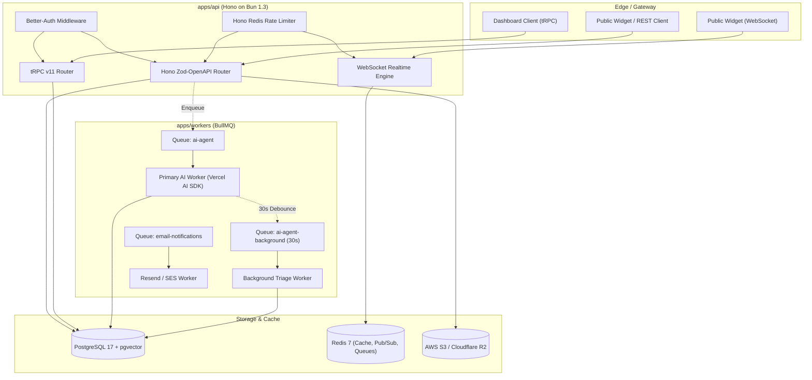

# 08 — Backend Architecture & Service Infrastructure

The Cossistant backend is engineered for high-throughput, low-latency concurrent conversations with strict multi-tenant data isolation.

---

## 1. High-Level Service Topology

---

## 2. Server Framework & Routing Architecture (`apps/api`)

* **HTTP Runtime:** Powered by **Hono** running natively on **Bun**. Hono was selected over Express or Fastify due to its zero-dependency footprint, native TypeScript support, and web-standard Request/Response APIs compatible with Edge runtimes.
* **Dual Endpoint Strategy:**
  1. **tRPC Router (`/trpc/*`):** Exposes 17 routers (`origamiTRPCRouter`) delivering full end-to-end type safety to the Next.js admin dashboard without manually syncing DTOs.
  2. **REST OpenAPI Router (`/api/v1/*`):** Handcrafted with `@hono/zod-openapi` and `@hono/zod-validator` for external consumption by mobile apps, custom customer scripts, and the lightweight `<Support />` widget.
* **Rate Limiting Middleware:**
  * Uses `@hono-rate-limiter/redis` with sliding-window counters in Redis.
  * Public widget endpoints are keyed by client IP + `websiteId` (120 requests/min).
  * API endpoints are keyed by API key hash (600 requests/min).
* **CORS & Domain Validation:**
  * Widget endpoints strictly validate the HTTP `Origin` header against the website's configured `allowedOrigins` database column. Requests from unauthorized domains are blocked with HTTP 403 Forbidden.

---

## 3. Asynchronous Worker Architecture (`apps/workers`)

Background processing is decoupled from the HTTP request cycle using **BullMQ** running against Redis 7:

### Queue Specifications:

1. **`ai-agent` (Primary Queue):**
   * **Job ID Format:** `ai-agent-${conversationId}` (Ensures strict conversation-level deduplication: at most one active or waiting primary execution per thread).
   * **Concurrency:** 10 workers per instance.
   * **Payload:** `{ conversationId, websiteId, organizationId, aiAgentId, runAttempt }`.
   * **Execution:** Runs `runPrimaryPipeline` to ingest unhandled customer messages, query knowledge embeddings via pgvector, execute tool calls, and push streaming tokens over WebSockets.

2. **`ai-agent-background` (Delayed Background Queue):**
   * **Job ID Format:** `ai-agent-background-${conversationId}`.
   * **Scheduling Strategy:** Debounced with a **30,000ms (30s) delay**.
   * **Reschedule Invariant:** If a customer sends another message while a background job is waiting, the prior job is canceled and replaced with a fresh 30s delay timer.
   * **Execution:** Performs asynchronous, non-blocking metadata tasks: generating concise thread titles, assessing visitor sentiment, detecting knowledge gaps, and updating search indexes.

3. **`email-notifications` Queue:**
   * Delivers transactional email alerts (new message alerts, team invites, password resets) via Resend or AWS SES with automatic exponential backoff retries.

---

## 4. Multi-Tenant Data Isolation Model

Cossistant enforces strict multi-tenancy at both the application and database layer:

* **Tenant Hierarchy:**
  `Organization` (Billing & Ownership) ➔ `Website` (Product boundary) ➔ `Conversation` (Support thread) ➔ `TimelineItem` (Individual messages).
* **Isolation Enforcement:**
  * Every database query in `apps/api/src/db/queries` includes explicit `where(eq(table.websiteId, currentWebsiteId))` or `where(eq(table.organizationId, currentOrgId))` predicates.
  * The tRPC middleware extracts and resolves the active tenant from session cookies and route parameters before executing procedure logic.
  * Public API keys (`pk_*`) are cryptographically bound to a single `websiteId` and verified during connection handshakes.

---

## 5. Storage & Static Asset Pipelines

* **File Uploads:** Customer attachments (screenshots, logs, error dumps) bypass the application server entirely.
* **Direct-to-S3 Presigning:**
  1. Client sends file metadata (filename, byte size, MIME type) to `POST /api/v1/uploads/presign`.
  2. Server validates file extension and size limits (`MAX_UPLOAD_SIZE = 10MB`).
  3. Server invokes `@aws-sdk/s3-request-presigner` to generate a presigned PUT URL with a 5-minute TTL.
  4. Client uploads directly to AWS S3 / Cloudflare R2 bucket.
  5. S3 public CDN URL is persisted in the `conversationTimelineItem` record.

