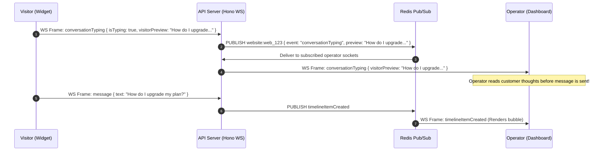

# 11 — Real-Time Architecture & WebSocket Subsystem

Cossistant incorporates a high-performance bi-directional messaging layer built with **Bun's native WebSockets** (`ServerWebSocket`) and **Redis 7 Pub/Sub** for cross-instance horizontal scaling.

---

## 1. Real-Time Topology & Pub/Sub Fan-Out

```
  [ Customer Chat Widget ]              [ Operator Dashboard ]
             │                                    │
    WebSocket Connection                 WebSocket Connection
             │                                    │
             ▼                                    ▼
   ┌───────────────────┐                ┌───────────────────┐
   │ API Instance #1   │                │ API Instance #2   │
   │ Local Connection  │                │ Local Connection  │
   │ Registry          │                │ Registry          │
   └─────────┬─────────┘                └─────────┬─────────┘
             │                                    │
             ▼                                    ▼
   ┌────────────────────────────────────────────────────────┐
   │                  Redis 7 Pub/Sub Bus                   │
   │   Channels:                                            │
   │   • `website:${websiteId}`                             │
   │   • `visitor:${visitorId}`                             │
   │   • `connection:${connectionId}`                       │
   └────────────────────────────────────────────────────────┘
```

When an event occurs on API Instance #1 (e.g., customer sends a message), it publishes the event payload to Redis channel `website:${websiteId}`. API Instance #2 receives the message via its Redis subscription, looks up active local connections matching `websiteId` in its memory registry, and dispatches the WebSocket frame down to the operator's browser.

---

## 2. Connection Lifecycle & Authentication

1. **Client Handshake:**
   Client opens WebSocket connection to `wss://api.cossistant.com/ws`.
   * For Customer Widget: Query string contains `?key=pk_...&visitorId=vis_...`.
   * For Operator Dashboard: Connection includes HTTP-only session cookie `cossistant_session`.
2. **Connection Registration (`connection-registry.ts`):**
   * Server validates publishable key or session token.
   * Generates unique `connectionId` (ULID).
   * Maps `connectionId` ➔ `RawSocket` with associated metadata:
     ```typescript
     type LocalConnectionRecord = {
       connectionId: string;
       socket: ServerWebSocket;
       websiteId: string;
       organizationId: string;
       visitorId?: string;
       userId?: string;
       authenticated: boolean;
     };
     ```
3. **Heartbeats & Keep-Alive:**
   * Ping/Pong frames every 30 seconds.
   * Redis presence timestamp updated via `updatePresenceIfNeeded` to maintain active online user counts in Tinybird.
4. **Disconnection & Cleanup:**
   * On socket close, `unregisterConnection` removes the socket from local memory and emits a `userDisconnected` or `visitorDisconnected` event to Redis.

---

## 3. Real-Time Event Catalog & Payloads

Every event conforms to `baseRealtimeEvent` (`websiteId`, `organizationId`, `visitorId`, `userId`):

| Event Name | Direction | Payload Structure | Functional Purpose |
| :--- | :--- | :--- | :--- |
| **`visitorPresenceUpdate`** | Client ➔ Server ➔ Redis | `{ visitorId, sessionId, activityType, currentPage, attribution }` | Broadcasts visitor browsing activity and page route changes. |
| **`conversationTyping`** | Bi-directional | `{ conversationId, isTyping: boolean, visitorPreview?: string }` | Streams live keystroke preview to operator; shows animated dots to visitor. |
| **`conversationSeen`** | Bi-directional | `{ conversationId, lastSeenAt, actorType: "visitor" \| "user" \| "ai_agent", actorId }` | Updates read-receipt checks immediately. |
| **`timelineItemCreated`** | Server ➔ Clients | `{ conversationId, item: TimelineItem }` | Delivers new text messages, tool execution cards, or system events. |
| **`userPresenceUpdate`** | Server ➔ Clients | `{ userId, status: "online" \| "away" \| "offline", lastSeen }` | Updates operator team roster status in widget header. |

---

## 4. Sequence Diagram: Live Keystroke Preview Flow



